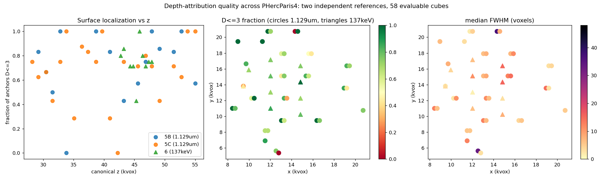

# Depth-attribution validation for 3D ink labels (villa #192)

This repository validates the depth component of 3D ink labels for the
Vesuvius Challenge against an independent scan, using the official landmark
transforms that ship inside the PHercParis4 volume zarrs. It responds to the
reopening condition stated when PR ScrollPrize/villa#1295 was closed: depths
must be "validated against an independent 3d reference".

Headline result: across 24 preregistered cubes (192 anchors, 142 evaluable),
99 of 142 anchors asserted by the official ink-3d prediction sit within 3
voxels (7.2um) of a papyrus surface measured only in the independently
scanned 1.129um volume; the exact one-sided binomial p-value against a
conservative chance model is 4.1e-24. About half the anchors carry depth
profiles as thin as a physical ink layer, one sixth are surface-localized but
depth-smeared, and three in ten are not surface-localized. Full method,
numbers, and claim limits are in [REPORT.md](REPORT.md).

This validates depth geometry only. It never measures ink identity, and the
report states that boundary explicitly.

## Update 2026-08-13: dual-energy replication and a first label artifact

Two additions after the original report:

- **Phase 6, energy-independent replication.** The same construct run against
  the 137keV scan (independent in beam physics, not only in scan session),
  with a preregistered per-cube NCC correction gate (two of twelve cubes
  failed the gate and were excluded whole). Result: 51 of 68 evaluable
  anchors within 3 voxels of the independently measured surface, exact
  binomial p = 3.0e-15. Three disjoint samples now agree (76%, 70%, 75%
  localized). See `phase6_result_2026-08-13.json`.
- **Phase 7, a depth-validated label artifact.** For segment
  `w00_20231016151002`, a full-resolution 3D label zarr whose depth is
  corrected by surface positions measured in the 1.129um scan at 148
  preregistered nodes, with a QC sidecar (correction field, per-node
  distance, validation status). At validated nodes the published annotation
  plane sits a median of 0.5 voxels from the independent surface. Honest
  limit: only 3.5% of ink pixels fall inside the validated region, because
  the 1.129um footprint covers part of the segment; the rest keep the
  published plane and are flagged unvalidated. The artifact stays local
  (data redistribution terms); the generator and journals are here.



## Layout

- `REPORT.md`: the full write-up.
- `PHASE5*_PREREGISTRATION_*.md`, `PHASE5*_CODE_FREEZE_ADDENDUM_*.md`: frozen
  designs, constants, gates, and code hashes, written before each run.
- `phaseA_crossres_registration_qa_2026-08-07.py`: registration chain QA
  (NCC 0.950 at a one-voxel offset).
- `crossscan_overlap_analysis_2026-08-07.py`: transform audit and footprint
  overlap computation.
- `phase5a_depth_attribution_run.py`, `phase5b_scaleup_run.py`,
  `phase5c_scaleup_run.py`: the pilot, the scale-up, and the confirmatory
  rerun. 5B and 5C fetch the chunks they need from the official open-data
  bucket and cache them locally.
- `tests/`: phantom and rule tests (16 tests; surface recovery within 0.5
  voxel, FWHM within 1 voxel, sampler tie policy, NCC shift recovery).
- `data_crossscan_meta_2026-08-07/`: copies of the three official
  `transform.json` files the chain is built on.
- `results/`: result JSONs with full per-anchor records, acquisition and
  selection journals, and post-hoc SHA-256 inventories of the chunk caches.

## Running

Python 3.13 with numpy, scipy, numcodecs. No GPU. From the repository root:

```bash
python -m pytest tests -q
python phase5b_scaleup_run.py --plan
python phase5c_scaleup_run.py
```

`phase5c_scaleup_run.py` reproduces the confirmatory result end to end,
downloading about 2 GB of chunks on first run. `phase5a_depth_attribution_run.py`
additionally expects the eight raw and one prediction chunk of the P50 cube
(chunk keys and hashes are pinned in the Phase 5A preregistration and
journals); it was run against a locally acquired snapshot that this
repository does not redistribute.

No volume data is redistributed here. Every binary chunk is fetched from the
official `vesuvius-challenge-open-data` bucket at run time, and the journals
pin the identity of everything that was fetched.

## License

MIT for all code and text in this repository. The underlying scan data
belongs to the Vesuvius Challenge and is governed by its own terms.
